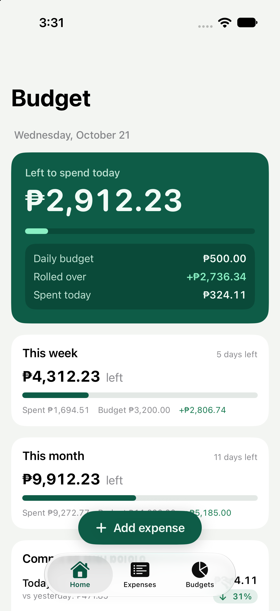
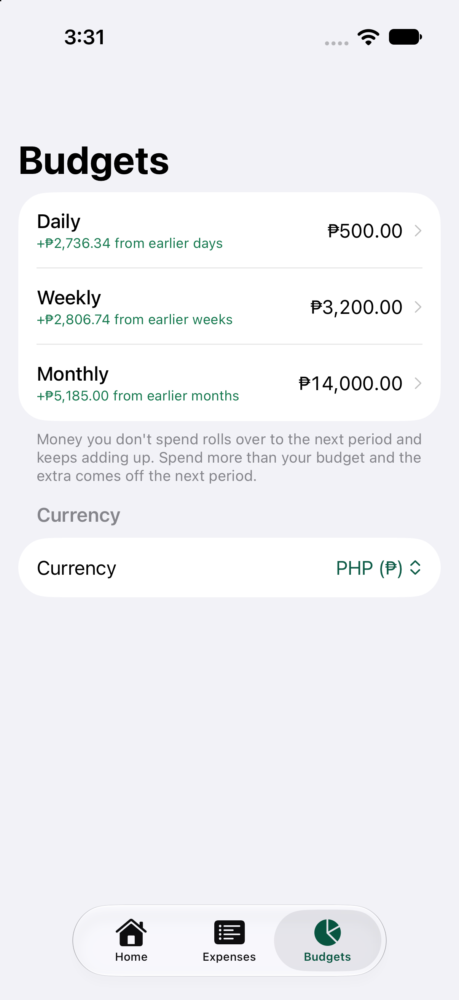
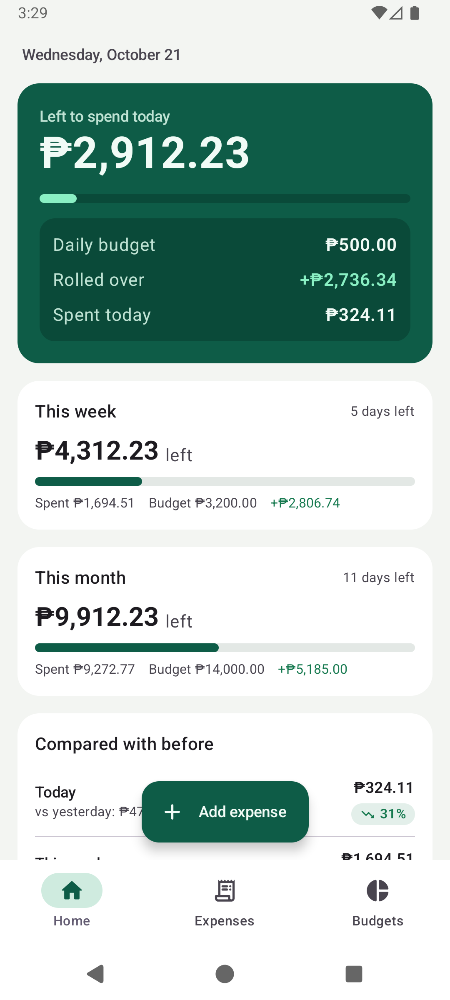
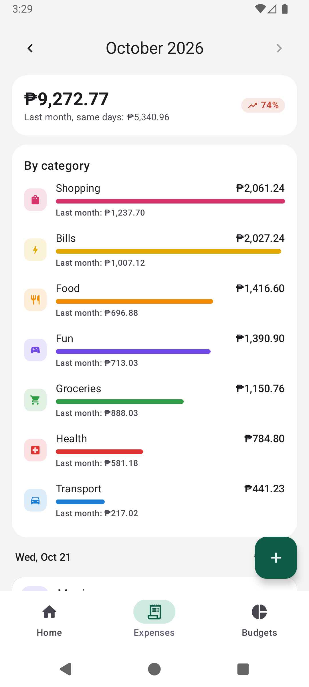

# Budget Tracker

An offline-first personal budget tracker for iPhone and Android, built with Kotlin Multiplatform. You log expenses, set
daily, weekly and monthly budgets, and see how your spending compares with earlier days, weeks and months. All data stays
in a local SQLite database. There are no accounts and no network.

| Home (iOS) | Budgets (iOS) | Home (Android) | Expenses (Android) |
|---|---|---|---|
|  |  |  |  |

## The rollover rule

Each budget (daily, weekly, monthly) keeps a signed running **carry**. When a period ends, `budget − spent` is added to it:

- Money you don't spend rolls into the next period and keeps adding up. It is shown separately as **Rolled over +₱X**.
- Overspending makes the carry negative. That amount (**Overspent before −₱X**) is taken off the period you are in now.
- Left to spend now = budget + carry − spent so far.

For example, with a daily budget of ₱500:

| Day | Carry in | Available | Spent | Carry out |
|-----|----------|-----------|-------|-----------|
| Mon | 0 | 500 | 300 | +200 |
| Tue | +200 | 700 | 450 | +250 |
| Wed | +250 | 750 | 900 | −150 |
| Thu | −150 | 350 | … | |

The carry is recomputed from your expenses and budget history every time and is never stored. Editing or deleting an old
expense therefore updates every later number. Changing a budget applies from the current period on, and past periods keep
the amount they had.

## Architecture

- `shared/`: one KMP module. `domain` is pure Kotlin: money, periods, the ledger and comparisons. `data` holds the
  SQLDelight repositories, `presentation` the shared ViewModels exposing `StateFlow`s, and `di` the Koin setup.
- `iosApp/`: SwiftUI (iOS 17+), with the project generated by XcodeGen from `project.yml`. Kotlin Flows reach Swift through SKIE.
- `androidApp/`: Jetpack Compose with Material 3.

Design spec: [`docs/design/2026-10-21-budget-tracker-design.md`](docs/design/2026-10-21-budget-tracker-design.md).
Plan: [`docs/plans/2026-10-21-budget-tracker.md`](docs/plans/2026-10-21-budget-tracker.md).

## Build and test

```bash
./gradlew :shared:allTests
```

```bash
./gradlew :androidApp:installDebug
```

```bash
./gradlew :androidApp:connectedDebugAndroidTest
```

```bash
cd iosApp && xcodegen && open Budget.xcodeproj
```

```bash
xcodebuild -project iosApp/Budget.xcodeproj -scheme Budget -destination 'platform=iOS Simulator,name=iPhone 17 Pro' test
```

### Sample data (debug builds only)

- iOS: add the launch arguments `-uiTestResetDB -seedSampleData` to start from a fresh database with about six weeks of
  sample spending.
- Android: run `adb shell setprop debug.budget.seed 1` and then launch the app with an empty database.

Running the iOS UI tests wipes the simulator's database.
